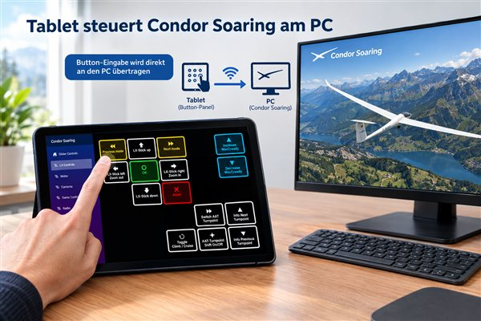
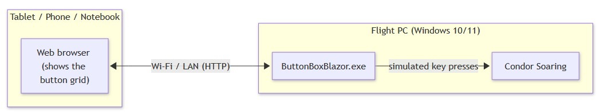
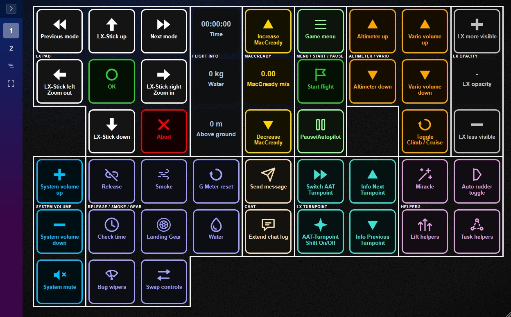
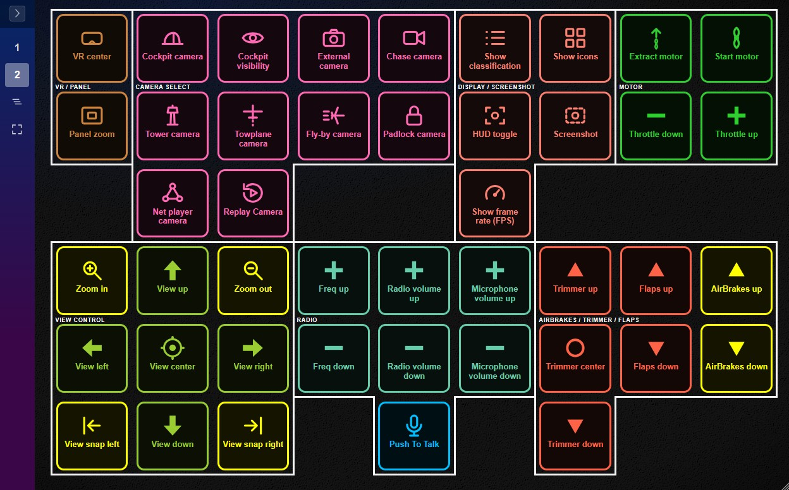
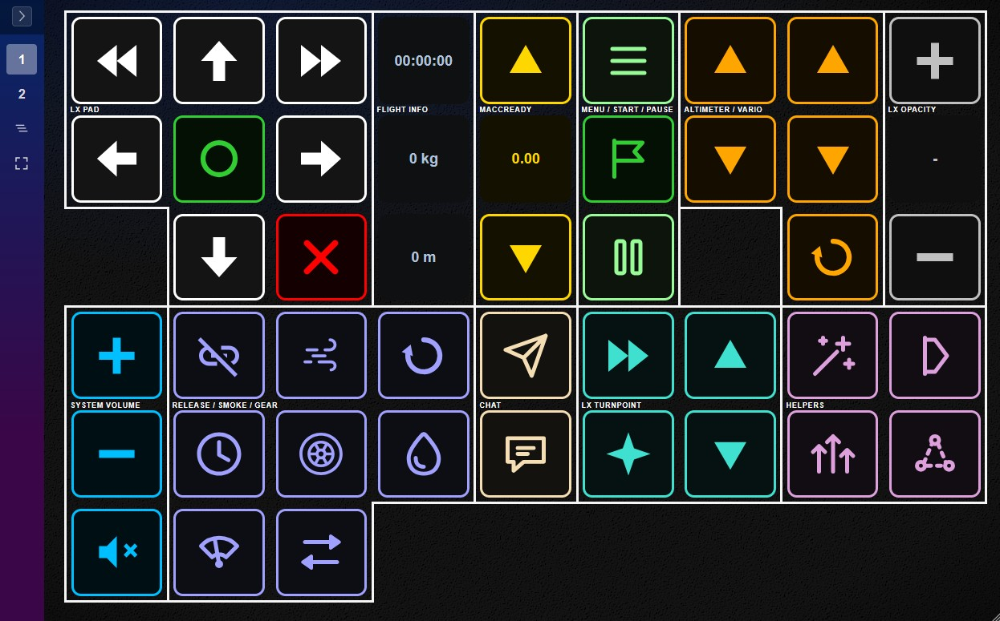
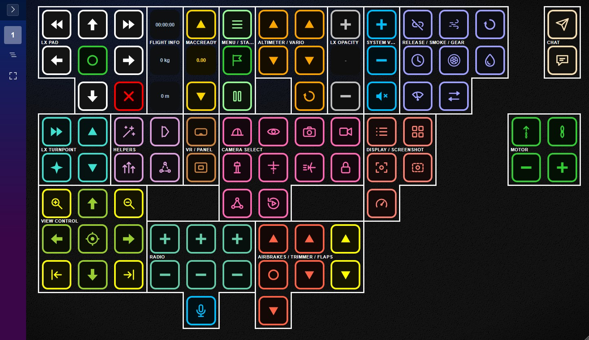
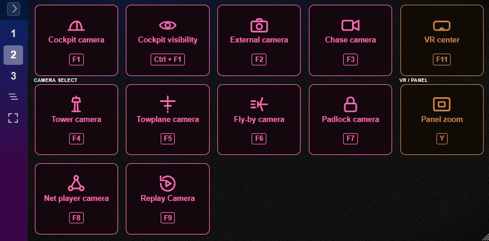
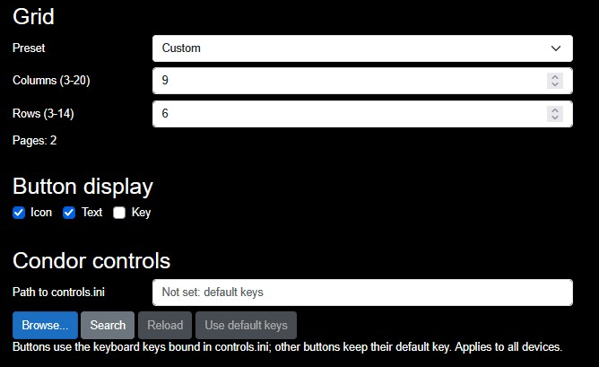
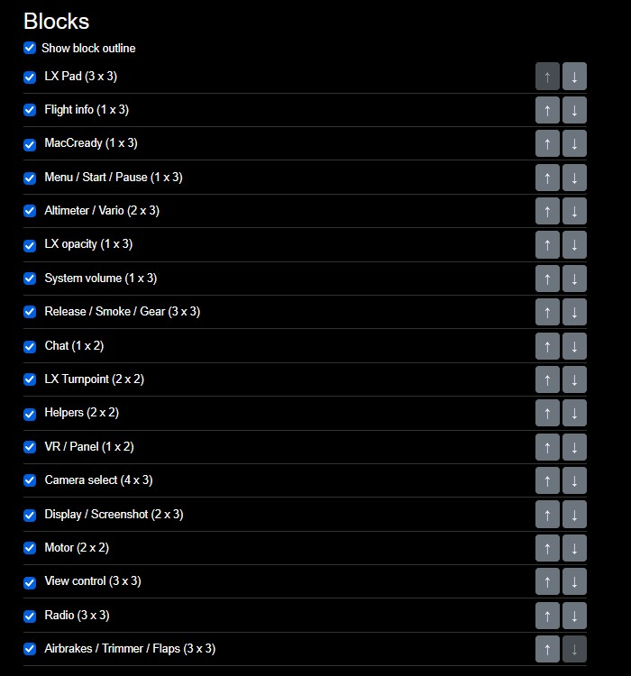

# Condor Button Box

A touch-friendly control panel for [Condor Soaring](https://www.condorsoaring.com/) that runs in your web browser. Instead of memorizing dozens of keyboard shortcuts for airbrakes, flaps, radio, LX instruments and more, you get a grid of labeled buttons you can tap on a tablet, phone, or a second PC while you fly.



## How it works (architecture)

1. You start `ButtonBoxBlazor.exe` on the **same PC that runs Condor**. It starts a small local web server.
2. A **second device** (tablet, phone, or another notebook — Android, iOS, Windows, doesn't matter, as long as it has a modern web browser) connects to that web server **over your local network (Wi-Fi/LAN)**.
3. You tap buttons on the second device, and the matching keyboard button is triggered on the flight PC — exactly as if you had pressed that key yourself.




## Features

- **Keyboard buttons** — Every Condor default key binding (airbrakes, flaps, radio, gear, ...) as a large, touch-friendly button. Press-and-hold buttons repeat while you keep your finger down.
- **Live Condor data via UDP** — Time, height, flaps, MacCready and water ballast are shown as info tiles, fed directly by Condor's UDP output. No more looking for small cockpit gauges. See [Setting up UDP.ini](#setting-up-udpini).
- **LX instrument controls, including Opacity** — Operate the LX navigation device from your tablet and adjust the opacity of the LX display on the flight PC with dedicated buttons.
- **Your own Condor key bindings** — The app reads your Condor `controls.ini` and uses the keyboard keys you assigned there, so the buttons keep working when you changed Condor's default keys. See [Using your controls.ini](#using-your-controlsini).
- **System volume** — Volume up, volume down and mute of the flight PC, so you can adjust sound without leaving the cockpit view.
- **Adjustable grid** — Choose the grid resolution to fit your screen and the size of your fingers: fewer, larger buttons or more, smaller ones.
- **Grid blocks** — Buttons that belong together (for example flaps or LX keys) are grouped into blocks with a clear outline. You see at a glance which controls belong to each other.
- **Smart layout via grid blocks** — Instead of dragging single buttons around the grid, you manage whole blocks. Show or hide blocks you don't need, change their order, and blocks that no longer fit are automatically moved to a new page.
- **Responsive design** — The grid adapts to the screen size and works on tablets, smartphones and PCs.

## Requirements

- Both devices (flight PC and your tablet/phone/notebook) must be connected to the **same local network** (same Wi-Fi/router). The app does not work over the internet and does not need internet access.
- Any reasonably modern web browser on the second device (Chrome, Edge, Safari, Firefox, etc.).

## Getting started

### 1. Start the app on the flight PC

Double-click `ButtonBoxBlazor.exe`.

The first time it runs, **Windows Defender Firewall** will show a warning asking whether to allow the app to communicate on your network. You must confirm/allow this (at least for "Private networks") — otherwise your tablet won't be able to reach it.

A console window stays open while the app runs; keep it running in the background (it doesn't need to be in focus). Closing that window stops the server.

### 2. Open the address on your second device

The console window prints the address to open, for example:

```
Available at: http://192.168.1.42:54738
```

Enter exactly that address in the browser of your tablet/phone/notebook. You should see the button grid. Add it to your home screen / bookmarks for quick access next time.

If several addresses are listed, use the one from the network your devices share (usually Wi-Fi or Ethernet).

## Using your controls.ini

Condor stores the key bindings of each pilot in `controls.ini`, usually at `Documents\Condor3\Pilots\<pilot>\controls.ini`. If you changed bindings in Condor, the button box has to send the same keys, otherwise Condor ignores the taps. 

### Setup

Open the **Settings** page and use the **Condor controls** section:

- **Search** lists the `controls.ini` files found in `Documents\Condor3\Pilots` (including the OneDrive-redirected Documents folder), most recently changed first. Click one to use it.
- **Browse...** opens a file dialog on the flight PC (not on your tablet) to pick the file manually.
- **Reload** reads the file again. Use it after you changed bindings in Condor while the button box was running.
- **Use default keys** forgets the file and returns to Condor's default key bindings.

A status line shows how many keyboard bindings were loaded, or that the file was not found or could not be read.

## Setting up UDP.ini

The info tiles (time, height, flaps, MacCready, water ballast) are fed by Condor's generic UDP output. It is enabled in the `UDP.ini` file in the Condor installation folder. Open it on the flight PC and set it to:

```ini
[General]
Enabled=1

[Connection]
Host=127.0.0.1
Port=55278

[Misc]
SendIntervalMs=100
ExtendedData=1
ExtendedData1=1
LogToFile=0
```

- `Enabled=1` switches the UDP output on. Restart Condor after changing the file.
- `Host=127.0.0.1` sends the data to the same PC, where the button box runs.
- `Port=55278` is the port the button box listens on. It is fixed, so don't change it.
- `SendIntervalMs=100` sends 10 data packets per second, which is plenty for the info tiles. Lower values only create more network load.
- `ExtendedData=1` adds the height above ground and the HUD messages.
- `ExtendedData1=1` adds the flaps position, the MacCready setting and the water ballast. Without it these tiles stay empty.
- `LogToFile=0` keeps the debug log off.


## Known limitations

- Only **keyboard key presses** are simulated. Gamepad/vJoy support is not planned, since it would make installation and setup considerably more complex for little gain.

# FAQ

## I’ve already assigned the button on my joystick
If the button is already assigned on your joystick, you shouldn’t need to have it on the Button Box as well. Otherwise, you should use Joystick Gremlin. Set the button back to its keyboard command, then use Joystick Gremlin to assign that keyboard key to your joystick.

# Demo

### Page 1


### Page 2


### Icons only


### I want it all


### Know your needs


### Setup your style and controls


### Select and organize your blocks


