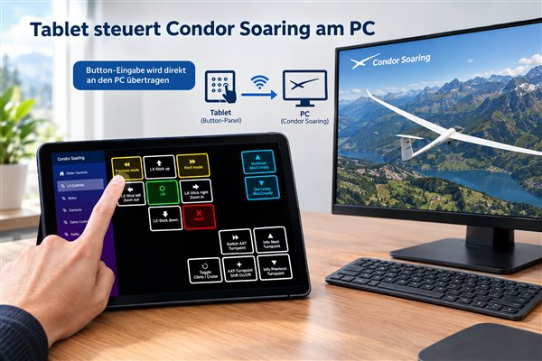
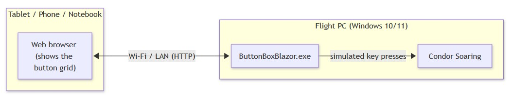
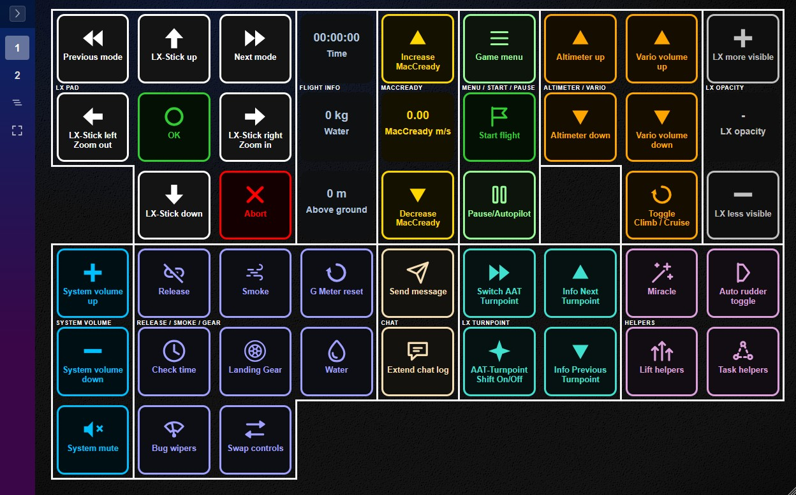
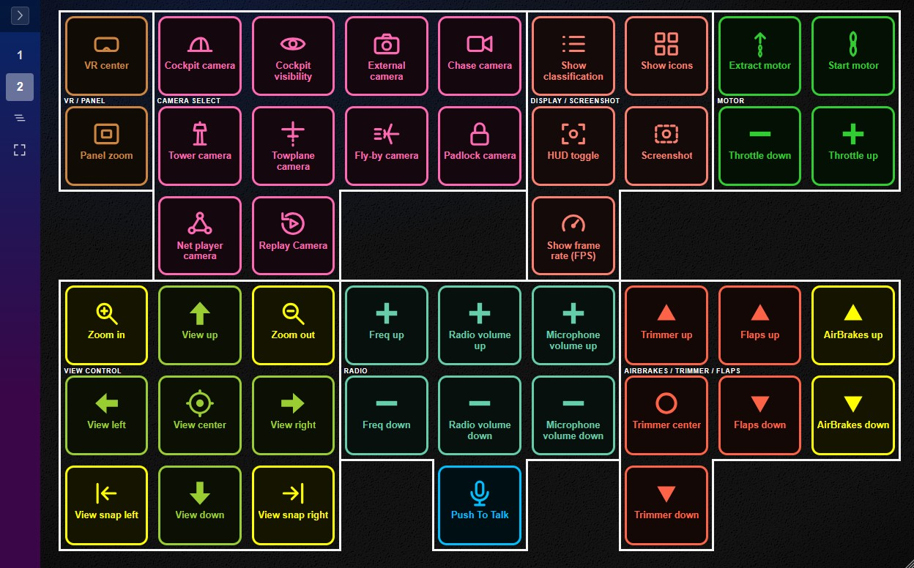
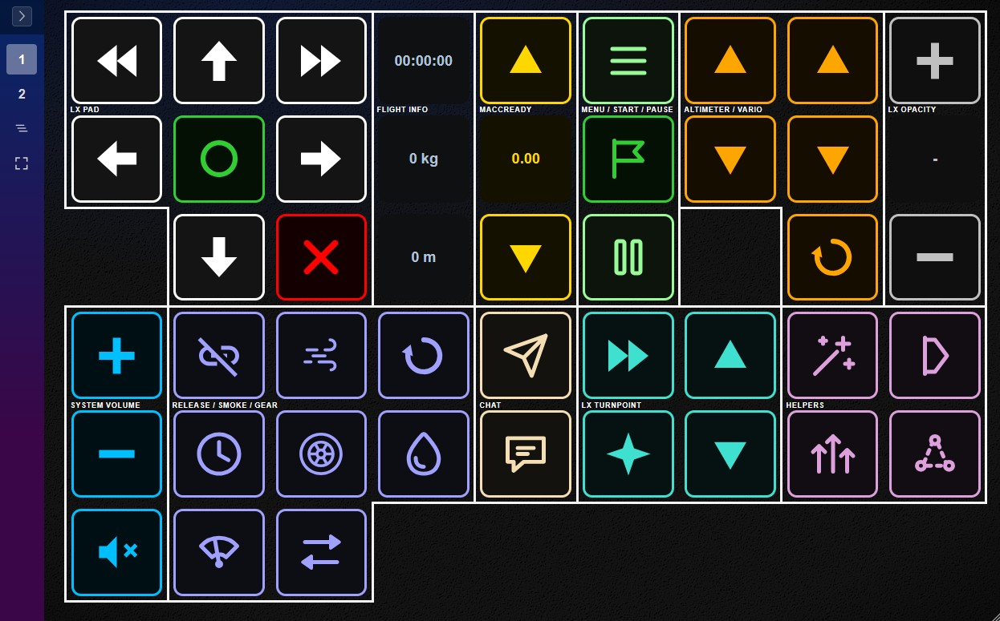
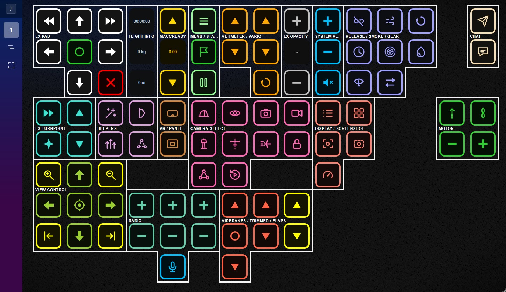
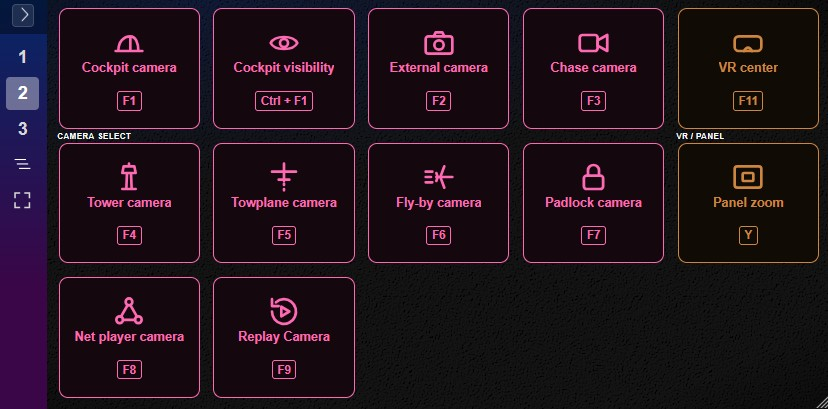
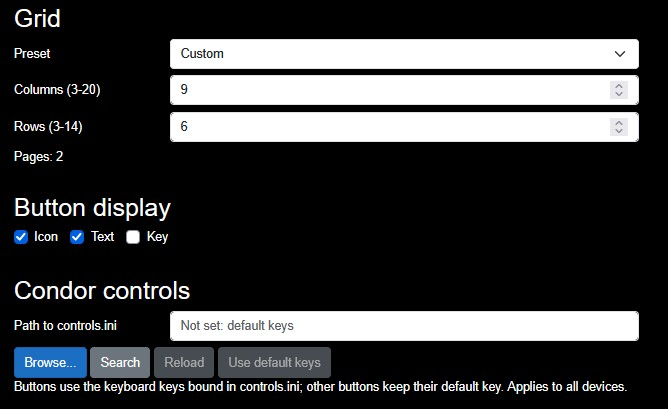
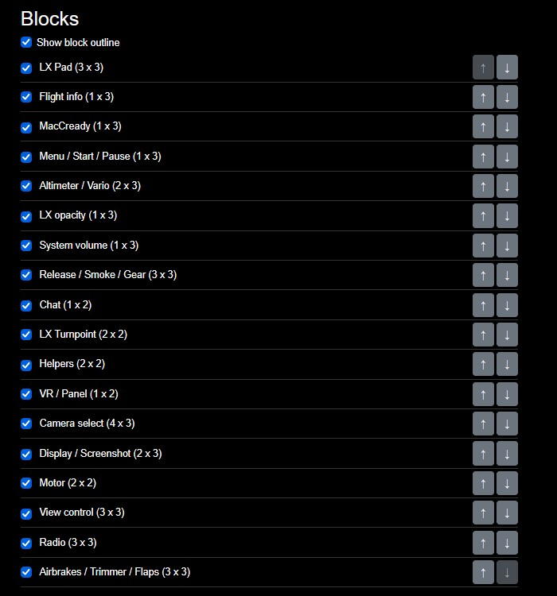

# Condor Button Box

A touch-friendly control panel for [Condor Soaring](https://www.condorsoaring.com/) that runs in your web browser. Instead of memorizing dozens of keyboard shortcuts for airbrakes, flaps, radio, LX instruments and more, you get a grid of labeled buttons you can tap on a tablet, phone, or a second PC while you fly.

<p align="center">

</p>

## Table of Contents <!-- omit in toc -->

- [Installation](#installation)
- [Getting started](#getting-started)
- [Requirements](#requirements)
- [How it works](#how-it-works)
- [Features](#features)
- [Using your controls.ini](#using-your-controlsini)
- [Setting up UDP.ini](#setting-up-udpini)
- [Customization](#customization)
- [Network access and security](#network-access-and-security)
- [Known limitations](#known-limitations)
- [FAQ](#faq)
- [Demo / Pictures](#demo--pictures)

## Installation

1. **Download the installer.** Open the [Releases page](https://github.com/PascalSchei/Button-Box/releases) and download `ButtonBox-Setup-<version>.exe` from the latest release.
2. **Run the installer on your flight PC.** It installs Button Box and automatically downloads and installs the required .NET 10 and ASP.NET Core 10 runtimes if they are missing, so no manual runtime download is needed. An internet connection is only required for this runtime download. Optionally, the installer creates a desktop shortcut.
3. Follow the [Getting started](#getting-started) instructions below to start Button Box and connect your tablet, phone, or second PC.

## Getting started

### 1. Start the app on the flight PC

Start **Button Box** via the desktop shortcut (or double-click `ButtonBoxBlazor.exe` in the installation folder).

The first time it runs, **Windows Defender Firewall** will show a warning asking whether to allow the app to communicate on your network. You must confirm/allow this (at least for "Private networks") — otherwise your tablet won't be able to reach it.

A console window stays open while the app runs; keep it running in the background (it doesn't need to be in focus). Closing that window stops the server.

### 2. Open the address on your second device

The console window prints the address to open, for example:

```
Available at: http://192.168.1.42:54738
```

As a first test, you can open that address in a browser on your flight PC.

Then enter exactly that address in the browser of your tablet/phone/notebook. You should see the button grid. Add it to your home screen / bookmarks for quick access next time.

If several addresses are listed, use the one from the network your devices share (usually Wi-Fi or Ethernet). Addresses of virtual adapters (Hyper-V, WSL, Docker, often ending in `.1`) are only reachable from the flight PC itself. Public internet addresses are never listed.

### 3. Test a button in Condor

Start Condor and load a flight. Bring the Condor window to the foreground on your flight PC, then tap a button on your second device, for example the landing gear button, and check that Condor responds.

Button Box sends keyboard input to the active window on your flight PC. Keep Condor in the foreground while using Button Box.  
If you opened the browser there for the first test, it will not work.

## Requirements

- Both devices (flight PC and your tablet/phone/notebook) must be connected to the **same local network** (same Wi-Fi/router). The app does not work over the internet and does not need internet access.
- Any reasonably modern web browser on the second device (Chrome, Edge, Safari, Firefox, etc.).

## How it works

1. You start `ButtonBoxBlazor.exe` on the **same PC that runs Condor**. It starts a small local web server.
2. A **second device** (tablet, phone, or another notebook — Android, iOS, Windows, doesn't matter, as long as it has a modern web browser) connects to that web server **over your local network (Wi-Fi/LAN)**.
3. You tap buttons on the second device, and the matching keyboard button is triggered on the flight PC — exactly as if you had pressed that key yourself.




## Features

- **Keyboard buttons** — Every Condor default key binding (airbrakes, flaps, radio, gear, ...) as a large, touch-friendly button. Press-and-hold buttons repeat while you keep your finger down.
- **Live Condor data via UDP** — Time, height, flaps, MacCready and water ballast are shown as info tiles, fed directly by Condor's UDP output. No more looking for small cockpit gauges. See [Setting up UDP.ini](#setting-up-udpini).
- **LX instrument controls, including Opacity** — Operate the LX navigation device from your tablet and adjust the opacity of the LX display on the flight PC with dedicated buttons.
- **Your own Condor key bindings** — The app reads your Condor `controls.ini` and uses the keyboard keys you assigned there, so the buttons keep working when you changed Condor's default keys. See [Using your controls.ini](#using-your-controlsini).
- **System volume** — Volume up, volume down and mute of the flight PC, so you can adjust sound without leaving the cockpit view.
- **Adjustable grid** — Choose the grid resolution to fit your screen and the size of your fingers: fewer, larger buttons or more, smaller ones.
- **Grid blocks** — Buttons that belong together (for example flaps or LX keys) are grouped into blocks with a clear outline. You see at a glance which controls belong to each other.
- **Smart layout via grid blocks** — Instead of dragging single buttons around the grid, you manage whole blocks. Show or hide blocks you don't need, change their order, and blocks that no longer fit are automatically moved to a new page.
- **Responsive design** — The grid adapts to the screen size and works on tablets, smartphones and PCs.
- **Local network only** — Connections from outside your local network are rejected by default. See [Network access and security](#network-access-and-security).

## Using your controls.ini

Condor stores the key bindings of each pilot in `controls.ini`, usually at `Documents\Condor3\Pilots\<pilot>\controls.ini`. If you changed bindings in Condor, the button box has to send the same keys, otherwise Condor ignores the taps. 

### Setup

Open the **Settings** page and use the **Condor controls** section:

- **Search** lists the `controls.ini` files found in `Documents\Condor3\Pilots` (including the OneDrive-redirected Documents folder), most recently changed first. Click one to use it.
- **Browse...** opens a file dialog on the flight PC (not on your tablet) to pick the file manually.
- **Reload** reads the file again. Use it after you changed bindings in Condor while the button box was running.
- **Use default keys** forgets the file and returns to Condor's default key bindings.

A status line shows how many keyboard bindings were loaded, or that the file was not found or could not be read.

## Setting up UDP.ini

**Optional: this setup is only needed for live data tiles. Buttons work without it.**

The info tiles (time, height, flaps, MacCready, water ballast) are fed by Condor's generic UDP output. It is enabled in the `UDP.ini` file in the Condor installation folder. Open it on the flight PC and set it to:

```ini
[General]
Enabled=1

[Connection]
Host=127.0.0.1
Port=55278

[Misc]
SendIntervalMs=100
ExtendedData=1
ExtendedData1=1
LogToFile=0
```

- `Enabled=1` switches the UDP output on. Restart Condor after changing the file.
- `Host=127.0.0.1` sends the data to the same PC, where the button box runs.
- `Port=55278` is the port the button box listens on. It is fixed, so don't change it.
- `SendIntervalMs=100` sends 10 data packets per second, which is plenty for the info tiles. Lower values only create more network load.
- `ExtendedData=1` adds the height above ground and the HUD messages.
- `ExtendedData1=1` adds the flaps position, the MacCready setting and the water ballast. Without it these tiles stay empty.
- `LogToFile=0` keeps the debug log off.


## Customization

Open the **Settings** page to adapt the button grid to your needs.

**Tip:** Open Button Box in two browsers. Use one as the preview and the other for the settings. Even better: open it on the target device (your tablet) and change the settings on the desktop, so you see the result live.

### Grid size

The **Preset** list offers ready-made grid sizes (for example **Tablet**). **Columns** and **Rows** define how many buttons fit on one page; changing them switches the preset to **Custom**. The number of pages is created automatically.

### Button display

Choose what each button shows: **Icon**, **Text** and **Key** (the keyboard key it sends). At least one of them stays enabled.

### Grid blocks

Buttons that belong together are grouped into grid blocks. Instead of showing all of them, think about which blocks you really need. The fewer blocks you show, the less searching during the flight.

- **Show or hide:** Use the checkbox next to a block to show or hide it.
- **Order:** Move a block up or down with the arrow buttons in the **Blocks** list. The order in the list is the order on the pages.
- **Placement:** Blocks are placed automatically from the top left to the right. When a page is full, the next block automatically moves to the next page.
- **Block outline:** **Show block outline** draws a frame around each block on the button pages.

### Pages

Pages are created automatically when the selected blocks no longer fit the grid. In **Settings > Blocks**, each page starts with a page-name row, initially **Page 1**, **Page 2**, and so on. The page row and the blocks below it share a background shade, alternating between lighter and darker for each page so you can see which blocks belong together.

- **Customize:** Click **Customize** on a page row to edit its name. Customized pages stay in edit mode when you reopen Settings.
- **Add Page:** Inserts a new page row directly below the current page row, with no block between them. The new page is immediately editable. Empty pages are allowed and saved.
- **Move a page break:** Use the arrows on a page row to move the break up or down by one block. Two directly adjacent page rows can also swap places, including their names. The first page row stays fixed.
- **Move a block across a page break:** A block's arrows swap it with the immediately adjacent row. If that row is a page break, the block crosses the break instead of swapping with the next block.
- **Delete:** Removes a customized page break and lets the blocks flow together again. On the first page, **Delete** only resets its name and customization; the first page itself remains.

Automatic page breaks are still added wherever the grid fills up, even when you use custom breaks. Moving an automatic break makes it a saved custom break.

Page names appear in the expanded left navigation and in the browser tab. The collapsed navigation continues to show only page numbers. Page names and custom breaks are saved and shared by all connected devices.

### Reset

**Settings > Reset** restores the defaults for all devices after a confirmation: grid, button display, block selection and order, page breaks, page names, the path to `controls.ini` and the [network setting](#allowing-all-networks). The `controls.ini` file itself is not changed. The defaults also apply after a restart.

## Network access and security

Button Box sends key presses to your flight PC, so only devices in your own network may use it. The app rejects every connection that does not come from one of these sources (HTTP status 403):

- the flight PC itself (`127.0.0.1`)
- private network ranges: `10.x.x.x`, `172.16.x.x` to `172.31.x.x`, `192.168.x.x` and `169.254.x.x`. This includes the usual home Wi-Fi, USB tethering and phone hotspots.
- the subnet of any network adapter of the flight PC, so networks with public addresses inside the LAN still work.

Connections from the internet are rejected, even if the port is forwarded on your router or the Windows firewall allows it. In addition, choose **Private networks** in the Windows firewall dialog on first start.

### Allowing all networks

VPN overlay networks such as Tailscale (`100.64.0.0/10`) are not private ranges and are rejected by default. If you connect through such a network, open **Settings > Network** and click **Allow all networks**. A warning asks for confirmation, because Button Box has no password: with this option anyone who can reach the flight PC can press keys on it. Click **Local networks only** to switch back. The setting is saved, shared by all devices and also cleared by **Reset**.

Every rejected connection is logged in the console window with its source address.

## Known limitations

- Only **keyboard key presses** are simulated. Gamepad/vJoy support is not planned, since it would make installation and setup considerably more complex for little gain.
- No full editor is planned in which every button can be designed and placed manually. Experience shows that only about one percent of users would use it, and it would cause 99% of the problems. I keep trying to find a good middle ground between simple operation and as much customization as possible.


## FAQ

### The app closes immediately after starting

A required runtime is probably missing on your flight PC, for example because the runtime installation during setup failed. Open a console (Command Prompt or PowerShell) and run:

```
dotnet --list-runtimes
```

The list must contain both of these entries with version 10:

```
Microsoft.NETCore.App 10.x.x
Microsoft.AspNetCore.App 10.x.x
```

If one is missing, download it from the [.NET 10 download page](https://dotnet.microsoft.com/en-us/download/dotnet/10.0) (**.NET Runtime 10** and **ASP.NET Core Runtime 10**), or run the installer again. Once installation is complete, start Button Box again.

### My tablet cannot open the page, or shows 403 Forbidden

**A. Windows firewall.** Make sure Button Box is allowed for **Private networks**. Windows sometimes classifies a new Wi-Fi or hotspot as *Public*. Change the network profile to *Private* in the Windows network settings, or allow the app for public networks.

**B. 403 Forbidden.** The tablet connects from a network that Button Box does not consider local, see [Network access and security](#network-access-and-security). The console window shows `Rejected connection from <address>`. If you trust that network (for example a VPN), enable **Allow all networks** in **Settings > Network**. Open Settings in a browser on the flight PC itself, because the rejected device cannot reach the page.

**C. Wrong address.** Use the address printed in the console window, not one from a virtual adapter.

### A Button Box button does not trigger any action

**A. The default key bindings in Condor Soaring have been changed.**

Open **Settings** in Button Box. Under **Condor controls**, click **Search** and select your pilot's `controls.ini` file. If it is already selected, click **Reload** to load your latest bindings.

**B. The function is assigned to a joystick button in Condor Soaring.**

Check the assignment in Condor Soaring's settings. Button Box sends keyboard key presses and cannot trigger functions assigned only to joystick buttons. Assign a keyboard key to the function so Button Box can trigger it.

### I’ve already assigned the button on my joystick
If the button is already assigned on your joystick, you shouldn’t need to have it on the Button Box as well. Otherwise, you can use Joystick Gremlin. Set the button back to its keyboard command, then use Joystick Gremlin to assign that keyboard key to your joystick.


## Demo / Pictures

### Page 1


### Page 2


### Icons only


### I want it all


### Know your needs


### Setup your style and controls


### Select and organize your blocks
